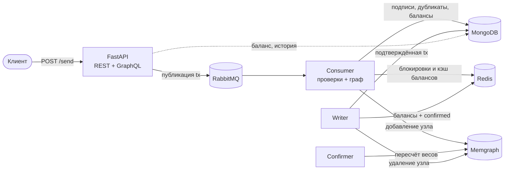

# l0-python

[](https://github.com/yzoz/l0-python/actions/workflows/ci.yml)

Прототип распределённого реестра транзакций на DAG. Проект использует FastAPI и Strawberry GraphQL для API, RabbitMQ для очередей, MongoDB для хранения подтверждённых транзакций, Redis для кэширования и Memgraph для графа транзакций. Подписи транзакций проверяются с помощью Ed25519 (PyNaCl).

## Возможности

- REST API и GraphQL для работы с транзакциями.
- Асинхронная обработка через RabbitMQ.
- Проверка цифровых подписей и обработка графа транзакций.
- Сервисы записи и подтверждения, а также утилиты для тестовой нагрузки.

Это исследовательский прототип, а не готовая финансовая система. Не используйте его для хранения реальных средств или секретов.

> Конвенция полей: `credit` — плательщик (отправитель средств), `debit` — получатель.
> Имена сохранены ради совместимости с существующими данными.

## Архитектура



### Поток транзакции

1. **send** — клиент отправляет подписанную транзакцию в `POST /send/`; API проверяет подпись Ed25519 и публикует сообщение в очередь `tx` RabbitMQ.
2. **consumer** — читает транзакцию, проверяет дубликаты и баланс, проверяет родителей, добавляет узел в граф Memgraph и связывает его с родителями.
3. **confirmer** — периодически пересчитывает веса узлов графа с затуханием по глубине потомков.
4. **writer** — подтверждает транзакции, чей вес превысил порог: пишет в MongoDB (источник истины), обновляет балансы в Redis и удаляет узел из графа.

## Требования

- Python 3.12+
- Poetry 2.x
- Docker Compose v2

## Настройка и запуск

```bash
git clone https://github.com/yzoz/l0-python.git
cd l0-python
poetry install
cp .env.example .env
```

Замените все значения в `.env` уникальными credentials. Не публикуйте файл `.env`. При публичном запуске InfluxDB credentials должны быть заменены, а ранее раскрытые значения — отозваны/ротированы.

---
При инициализированных данных запускается одной командой в многопанельном tmux:

```bash
./start
```
---

Запустите локальные зависимости (порты привязаны к loopback):

```bash
docker compose up -d
```

Инициализируйте данные при необходимости:

```bash
poetry run python genesis.py
```

Запустите API:

```bash
poetry run fastapi run api.py --host 127.0.0.1 --port 8000
```

- REST/OpenAPI: <http://127.0.0.1:8000/docs>
- GraphQL: <http://127.0.0.1:8000/graphql>

Фоновые процессы запускаются отдельно; замените `SERVICE` на `cons`, `conf` или `write`:

```bash
poetry run python service.py SERVICE
```

Остановка зависимостей: `docker compose down`. Для удаления также сохранённых данных используйте `docker compose down -v`.

Частые команды также собраны в `Makefile` (`make up`, `make genesis`, `make api`, `make cons`, `make conf`, `make write`, `make tx`, `make logs`, `make install`, `make test`, `make test-all`, `make lint`, `make down`).

## Примеры API

### REST: отправка транзакции

```bash
curl -X POST http://127.0.0.1:8000/send/ \
  -H 'Content-Type: application/json' \
  -d '{
    "content": {
      "parents": ["<hash-1>", "<hash-2>"],
      "credit": "<адрес плательщика>",
      "debit": "<адрес получателя>",
      "amount": 1000,
      "uniq": "<uuid>",
      "msg": "hello"
    },
    "sign": "<hex-подпись Ed25519>"
  }'
```

Успешный ответ: `{"detail": [{"success": 1, "msg": "ok"}]}`. При неверной подписи — `400`, при недоступности очереди — `503`.

### REST: выбор родителей для новой транзакции

```bash
curl http://127.0.0.1:8000/pool
```

### GraphQL: история и баланс

```bash
curl -X POST http://127.0.0.1:8000/graphql \
  -H 'Content-Type: application/json' \
  -d '{"query": "{ tx(addr: \"<адрес>\", limit: 10) { hash credit debit amount time msg } }"}'
```

```bash
curl -X POST http://127.0.0.1:8000/graphql \
  -H 'Content-Type: application/json' \
  -d '{"query": "{ balance(addr: \"<адрес>\") }"}'
```

## Тесты

Обычный набор использует моки и не требует запущенных баз данных:

```bash
poetry run pytest
```

Интеграционные тесты помечены `integration` и исключены из обычного прогона. Для теста балансов сначала запустите зависимости, затем выполните:

```bash
poetry run pytest -m integration
```

## Линтер

```bash
poetry run ruff check .
poetry run ruff format --check .
```

## Структура

- `api.py` — приложение FastAPI.
- `src/api/` — REST и GraphQL маршруты.
- `src/database/` — клиенты MongoDB, Redis, RabbitMQ и Memgraph.
- `src/utils/` — криптография, балансы и вспомогательные функции.
- `src/config.py` — общие константы проекта.
- `service/` — consumer, confirmer и writer.
- `tests/` — unit и интеграционные тесты.
- `docker-compose.yaml` — локальные сервисы разработки.

## Лицензия

MIT. См. [`LICENSE`](LICENSE).
